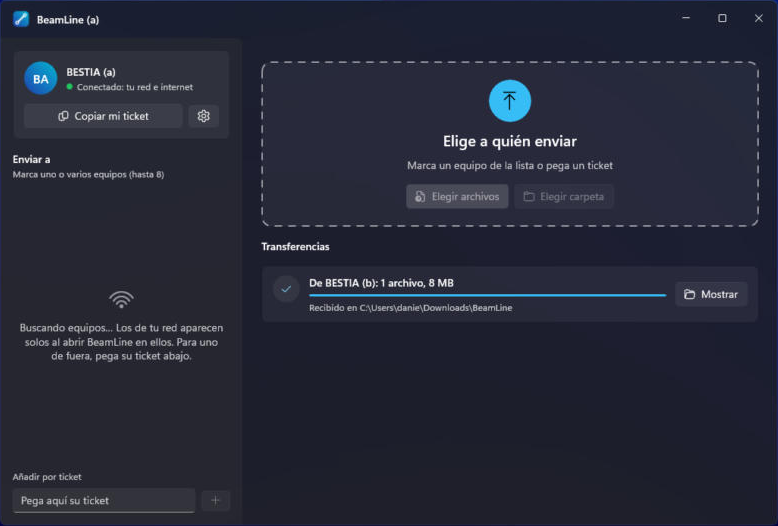

# BeamLine

Envía archivos y carpetas de cualquier tamaño entre equipos, en la misma red o por internet, sin cuenta ni nube. Es como LocalSend, pero también funciona fuera de casa. Usa iroh (QUIC con TLS 1.3, cifrado de extremo a extremo) e iroh-blobs (verificación BLAKE3 por trozos y reanudación).

- **Los de tu red aparecen solos.** A uno de fuera le pasas tu ticket.
- **El otro decide qué acepta**, archivo por archivo. Los equipos de confianza pueden guardar sin preguntar.
- **Si se corta, sigue donde iba.** No pisa nada: si un nombre ya existe con otro contenido, guarda «nombre (2)».
- **A varios a la vez** (hasta 8): los receptores se reparten el trabajo y el que envía sube cada byte una sola vez.
- **La primera vez**, Windows pide permiso en el cortafuegos: hay que aceptarlo en redes privadas para que te vean los de tu red.
- **Sin pasar archivos por servidores ajenos:** con el relé público de n0 solo hay conexión directa. Para internet sin conexión directa se puede poner un relé propio.



## Cómo se ejecuta

Windows (WinUI 3, Native AOT): `build\app.ps1` publica en `dist\BeamLine` y `build\distribuir.ps1` hace el zip, el instalador y la entrada del catálogo.
Linux (Uno sobre X11, Native AOT; glibc 2.34 o más nuevo, como Ubuntu 22.04 o Debian 12; en Wayland, por XWayland): `build\app-linux.ps1 -Autoprueba` compila y prueba en un contenedor de Docker, y deja `dist\BeamLine-<versión>-linux-x64.tar.gz`.

```powershell
. build\entorno.ps1
cd red; cargo test            # núcleo en Rust
dotnet test BeamLine.slnx     # cliente en C#, con procesos reales
powershell -File build\app.ps1 -Autoprueba
```

## Cifras

- **Directa:** 134 MiB/s entre dos procesos en este PC (fase 0).
- **Red simulada** (contenedores con `tc netem`, `docs/medir-entre-pc.md`): ver la tabla del 23-nov.
- **A tres a la vez:** el emisor sube 1,0 veces el tamaño.

Licencia: GNU GPL versión 3, solo la versión 3 (`GPL-3.0-only`); ver [LICENSE](LICENSE). Componentes de terceros en [LICENCIAS.md](LICENCIAS.md).

Detalle en `docs/` (`plan.md`, `protocolo.md`, `medir-entre-pc.md`, `pruebas-a-mano.md`) y estado en `CLAUDE.md`.
